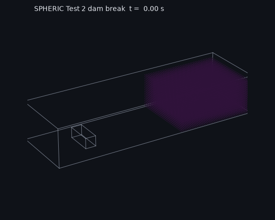
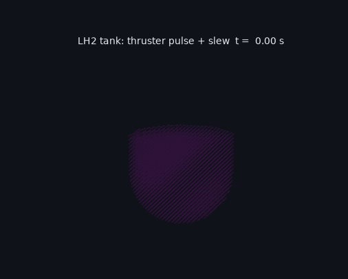
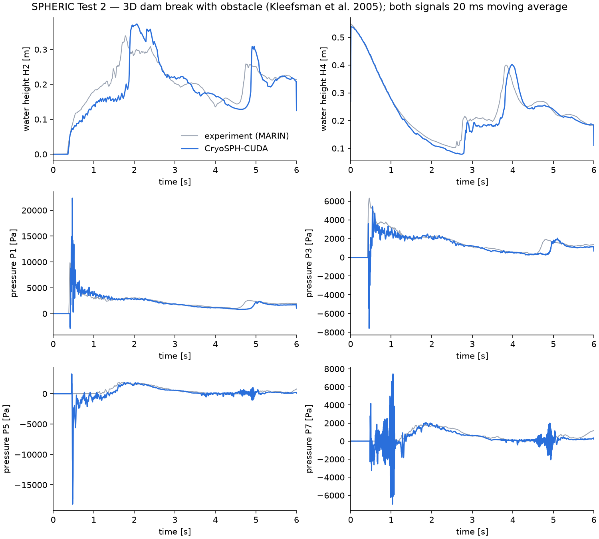
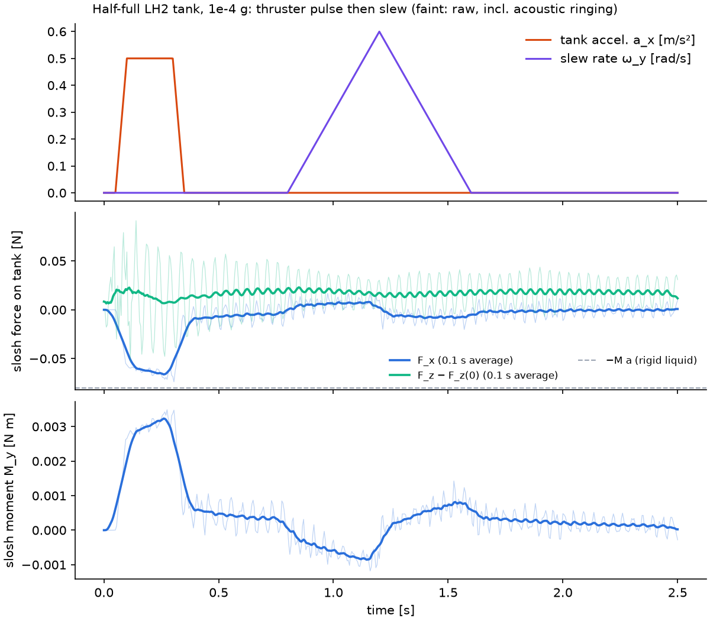

# CryoSPH-CUDA

[](https://github.com/Semedo2002/Microgravity-Cryogenic-Multi-Phase-SPH-Solver/actions/workflows/ci.yml)
[](https://colab.research.google.com/github/Semedo2002/Microgravity-Cryogenic-Multi-Phase-SPH-Solver/blob/main/examples/colab_quickstart.ipynb)
[](LICENSE)

A GPU particle solver (SPH) for liquid propellant in spacecraft tanks: sloshing,
surface tension and wetting in microgravity, boil-off and tank
pressurisation, and the loads the liquid puts on the tank when the
spacecraft manoeuvres. It runs on NVIDIA GPUs with CUDA, and the same code
builds for the CPU with OpenMP.

<p align="center">
  
  
</p>

*Left: the MARIN dam-break experiment, simulated and compared with the lab
data below. Right: a half-full liquid-hydrogen tank in 1e-4 g during a
thruster pulse and a slew.*

## What it does

- Two-phase liquid/vapour flow at cryogenic density ratios (50–180x), with
  presets for LH2, LN2, LOX, methane and water
- Surface tension (CSF) and contact angles, which dominate in microgravity
- Heat conduction, heater bands, and evaporation and condensation (Lee model)
  with exact mass and energy bookkeeping; vented or closed tanks with
  self-pressurisation
- Prescribed spacecraft manoeuvres (acceleration and rotation) and the
  resulting slosh force and moment on the tank
- Tank shapes from signed distance functions, OBJ meshes and boolean
  combinations (internal obstacles, baffles)
- Python API, VTK output for ParaView, and a browser viewer

## Results

**Lab validation: SPHERIC Test 2 dam break** (MARIN, Kleefsman et al. 2005).
A water column collapses into a tank and hits a box; water heights and impact
pressures were measured. The run used 80k particles and 6 s of simulated time,
and took about 1 h on a Quadro P1000.



| Signal | NRMSE |
|---|---|
| Water height H4 / H2 | 0.066 / 0.135 |
| Pressure P1 / P3 (front of box) | 0.106 / 0.150 |

The wave arrives within 0.06 s of the experiment, and the pressure decay that
follows tracks it closely. Two parts match less well: the impact peak is noisy
(22 kPa vs 10 kPa measured), and the wave returning from the far wall arrives
0.15–0.25 s late.

**Slosh loads during a manoeuvre.** During a lateral thruster pulse the side
force approaches the rigid-liquid value −M·a, and the slew moment flips sign
between spin-up and spin-down. The test suite checks the loads against exact
answers: M·(g − a) for a settled tank, and the centrifugal pressure field
ρω²r²/2 for a spinning tank.



**Violent boiling.** Closed LN2 tanks with up to 5 K superheat and Lee
coefficients up to 20 s⁻¹ keep the interface intact. Mass error stays at or
below 2.5e-6, and energy error is under 1 % of the latent heat moved.

## Build

Requirements:

- CMake ≥ 3.24 and a C++20 compiler
- CUDA ≥ 12 (optional)
- Python with NumPy (optional)

GoogleTest and pybind11 are used if they are installed, and downloaded
otherwise.

```bash
cmake -S . -B build -G Ninja -DCMAKE_BUILD_TYPE=Release -DCMAKE_CUDA_ARCHITECTURES=native
cmake --build build -j
ctest --test-dir build --output-on-failure            # 32 C++ tests
PYTHONPATH=build/python python -m pytest tests/python -q   # 9 Python tests
```

For a CPU-only build, add `-DCRYOSPH_ENABLE_CUDA=OFF`. Both backends pass the
same tests, and runs are bitwise reproducible.

## Run something

```bash
export PYTHONPATH=build/python
python examples/maneuver_slosh.py             # out/maneuver: loads plot, CSV, frames
python examples/boiloff_cylinder.py --t-end 2 # out/boiloff: pressure plot, CSV, VTK
python examples/reorientation.py              # LH2 bubble under settling thrust
python examples/high_evaporation.py           # out/high_evaporation/summary.csv
python validation/spheric_test2/fetch_data.py # downloads the MARIN data
python validation/spheric_test2/run.py --dx 0.03 --free-slip  # ~1 h on a small GPU
```

Results go to `out/` as plots, CSV files and VTK files for ParaView. To watch a
run in 3D:

1. Start `python -m http.server` in the repo.
2. Open `http://localhost:8000/viz/`.
3. Load a manifest such as `../out/maneuver/manifest.json`, or use "Open
   folder" to load an output directory.

The [Colab notebook](examples/colab_quickstart.ipynb) needs no local setup.

A minimal script:

```python
import CryoSPH as cs

ln2 = cs.FluidProperties.liquid_nitrogen()
cfg = cs.SolverConfig()
cfg.dx = 0.004
cfg.gravity = (0, 0, -9.81e-4)
cfg.thermo_mode = cs.TankThermoMode.Closed
cfg.heater_power = 20.0

solver = cs.Solver(cfg, ln2)
fill = cs.FillSpec()
fill.fill_fraction = 0.5
solver.build_tank(cs.CylinderTank(radius=0.05, height=0.12), fill)
solver.relax(0.05)
solver.run_until(1.0)
print(solver.diagnostics().p_ullage)
```

## Limitations

- Weakly compressible SPH leaves some velocity noise at interfaces. In a still
  LN2 drop it is about 0.5–0.7 cm/s, so flows slower than that aren't resolved.
- Contact angles come out within about 8° of the target; the goal is 5°.
- Fluid properties are constant, the ullage state is lumped, and walls are rigid.

[docs/design-notes.md](docs/design-notes.md) covers the numerical choices and
how each was tested, determinism, performance numbers, and approaches that
didn't work.

## Layout

```
include/, src/   solver (core, physics, solvers) and Python bindings
tests/           C++ (GoogleTest) and Python tests
benchmarks/      performance benchmark
examples/        example scripts and the Colab notebook
validation/      SPHERIC Test 2 runner and comparison
viz/             browser viewer
tools/           GIF renderer
paper/           JOSS paper draft
```

## License

MIT. To cite this project, see [CITATION.cff](CITATION.cff).
